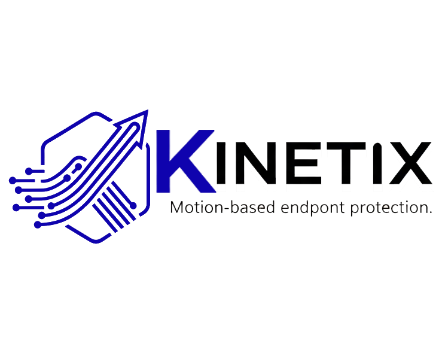

# Kinetix: Enterprise Endpoint Management



## Overview
Kinetix is a professional-grade, Django-based endpoint management system designed for secure Windows update delivery, real-time device monitoring, and remote software management. It features a high-performance **pull-based architecture** where remote agents poll the command center for instructions, ensuring compatibility with strict corporate firewalls without compromising security.

---

## 🚀 Key Features

### 💻 Device Management & Insights
- **Deep Device Visibility:** Interactive detail modals showing **Last Boot Time**, **System Uptime**, **Logged-in User**, and management notes.
- **Console User Tracking:** Automatically identifies and reports the active Windows user using WMI.
- **Detailed Inventory:** Real-time tracking of Windows Services and Installed Applications.
- **Proactive Sync:** Agents automatically repopulate inventory data immediately after registration, service restarts, or server-side deletion.
- **Instant Refresh:** Trigger immediate inventory collection from the dashboard.
- **Advanced Device Table:** Enhanced visibility with **Group**, **Status**, and **Connectivity** indicators.
- **Real-Time Inventory Status:** New **Inventory Status** column tracking refresh cycles (Idle -> Requested -> Processing -> Completed).
- **Edit & Organize:** Remotely edit device hostnames, assign groups, and manage operational status with full RBAC protection (`change_device` permission).
- **Mass Refresh:** Trigger a fleet-wide inventory update with a single click using the **"Refresh All Devices"** feature.
- **Deep Insights:** Detailed modals showing **Last Boot Time**, **System Uptime**, **Logged-in User**, and internal management notes.
- **Automatic Polling:** Dashboard automatically refreshes connectivity and status indicators without manual page reloads.

### 📦 Software Deployment & Lifecycle
- **Advanced Update Center:** Upload and deploy MSI/EXE updates with support for decimal versioning (e.g., `1.2.3.4`).
- **Proactive Inventory Sync:** The application inventory is automatically updated immediately after a successful software installation.
- **Remote Uninstallation:** Remotely remove software using the Windows Registry's `QuietUninstallString` with automatic silent-flag injection.
- **Update Resiliency:** Intelligent "wait-for-online" queueing. Updates are delivered when devices reconnect, adhering to user-defined schedules.
- **Smart Retries:** One-click "Retry" functionality for failed deployments with full error logs from the remote installer.
- **Granular RBAC:** Access to Update Center is restricted to authorized personnel. Separate permissions for uploading (`add_update`) and deploying (`can_deploy_updates`).
- **Device Group Deployment:** Deploy software to entire groups with a single click. (Requires groups to have $\ge 1$ device).
- **Deployment Logs:** Detailed per-deployment log viewer showing agent execution status and server-side task results.
- **Real-Time Progress:** Deployment table polls automatically to show success/failure status as agents report back.
- **RSA Signing & Malware Scanning:** Integrated VirusTotal and ClamAV scanning with RSA-4096 (PSS) signature verification.

### ⚙️ Deep Inventory & OS Insights
- **Fleet-Wide Services:** Dedicated **Services Tab** to view and search all Windows services across all managed devices.
- **Update History Tabs:** Separated device history into **Kinetix Deployments** and **Windows Updates (OS KBs)**.
- **OS Update Tracking:** Automatically retrieves and logs the history of installed Windows Update KBs directly from the device.
- **System Metrics:** Reliable collection of **Boot Time** and **System Uptime** using a multi-layered fallback strategy (`psutil`, WMI, `ctypes`).

### 🛠️ Remote Administration (Remote Actions)
- **Interactive Remote Reboot:** Trigger a managed restart with a custom administrator message.
    - **Client-Side UI:** Users see a branded popup with options to "Restart Now" or "Later" (30m, 1h, 2h, 4h).
    - **Session 0 Bypass:** Uses Windows Task Scheduler (`schtasks`) to display interactive GUIs from the SYSTEM service session.
    - **Smart Postponement:** Non-blocking postponement timers using `tkinter.after`.
- **Service Control:** Remotely start or stop Windows services with robust error handling (handles "already running/stopped" states).
- **Remote Shell:** Execute arbitrary shell commands on endpoints with real-time output capture.
- **Dynamic Registry Management:** Remotely create or modify Windows Registry keys and values (HKLM, HKCU, HKCR, HKU) with support for REG_SZ, REG_DWORD, etc.
- **Command Tracking:** Real-time monitoring of remote command execution status (Pending -> Sent -> Completed/Failed).
- **Asynchronous Execution:** Agent processes commands in background threads to ensure the service remains responsive during long-running tasks.
- **Interactive Remote Reboot:** Trigger managed restarts with custom admin messages. Uses a robust `schtasks` bypass to display GUIs across Session 0 boundaries.
- **Automatic Inventory Sync:** Any action (editing details, changing services, uninstalling apps, reboots) automatically triggers a proactive inventory refresh.
- **Agent Self-Management:** Remotely restart the Kinetix Agent service directly from the dashboard.
- **Command Traceability:** Structured command logging on the agent (`logs/command_history.log`) for full auditability.

### 📊 Reporting & Auditing
- **Deployment Reports:** Comprehensive status tracking for all software pushes with **CSV Export** capability.
- **System Audit Logs:** Dedicated logs page capturing every user and device action with severity levels and IP tracking.
- **Visual Analytics:** Real-time dashboard with online/offline status, OS distribution, and deployment activity history.

### 🛡️ Enterprise-Grade Security
- **Hardened Production Mode:** Support for `DEBUG=False` with secure media serving and CSRF meta-tag fallbacks for AJAX reliability.
- **Encrypted Communication:** Full JWT authentication for agents and Fernet encryption for sensitive database fields.
- **RSA Signing:** Update files are signed with RSA-4096 (PSS padding) to ensure authenticity and integrity.
- **Malware Scanning:** Integrated VirusTotal and ClamAV scanning for all uploaded software updates.
- **Remote Config Sync:** Remotely adjust the fleet's poll interval (heartbeat frequency) directly from the Command Center UI.
- **Hardened RBAC:** Fine-grained permissions for all remote actions, integrated with Django's standard permission system.
- **Encrypted Communication:** Full JWT authentication for agents and AES-256 field encryption for sensitive configuration.
- **CSRF Protection:** Secure AJAX communication for all dashboard remote actions.
---

## 🏗️ Architecture
- **Backend:** Django 5.x + Django REST Framework.
- **Task Queue:** Celery + Redis for asynchronous deployment and scanning.
- **Frontend:** Bootstrap 5 + DataTables.js + Chart.js.
- **Agent:** Python-based Windows Service (compiled to EXE/MSI) with Tkinter-based interactive UI.
- **Security:** RSA-4096 signing, AES-256 field encryption, JWT Auth.

---

## 🛠️ Installation & Setup

### Quick Start (Windows Development) ⚡
1. **Setup Environment:** Run `quickstart.bat` to automate virtual environment and dependency installation.
2. **Start Services:** Run `run_dev.bat`. This launches the Django server, Celery worker, and Celery beat in separate windows.
3. **Access Dashboard:** Open `http://localhost:8000` (Default credentials: `admin` / `admin`).

### Production Deployment
1. **Configuration:** Set `DEBUG=False` in your `.env` file.
2. **Launch:** Use `production_server.bat` to start the high-performance Waitress WSGI server.
3. **HTTPS (Optional):** Configure `SESSION_COOKIE_SECURE=True` and `CSRF_COOKIE_SECURE=True` in `.env` if using SSL.

---

## 🤖 Agent Management

The Kinetix Agent runs as a silent Windows Service.

**Manual Commands (from agent directory):**
- `kinetix_agent.exe inventory`: Force immediate inventory upload.
- `kinetix_agent.exe register`: Force manual re-registration.
- `kinetix_agent.exe set-server <url>`: Update the Command Center address.
- `kinetix_agent.exe restart`: Restart the service to apply configuration changes.

---

## 📁 Project Structure
```text
Kinetix/
├── agent/               # Windows Agent source, GUI, and installer scripts
├── api/                 # REST API (Agent-to-Server communication)
├── core/                # Core logic, Models (Device, Command, Config), and Security
├── dashboard/           # UI Views and Dashboard logic
├── inventory/           # Inventory data models and processing
├── updates/             # Software update management and deployment tasks
├── templates/           # HTML Templates (Dashboard, Reports, Logs)
├── keys/                # RSA Signing keys (Auto-generated)
├── logs/                # System and Agent log files
├── diag.py              # System diagnostic tool
└── requirements.txt     # Backend dependencies
```

---

## 📜 License
Proprietary - All Rights Reserved.

## 🏷️ Version
1.3.0 (January 2026) - *Hardened Service Control & Shell Update*